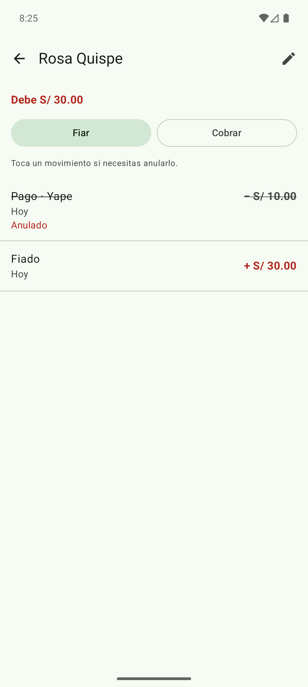
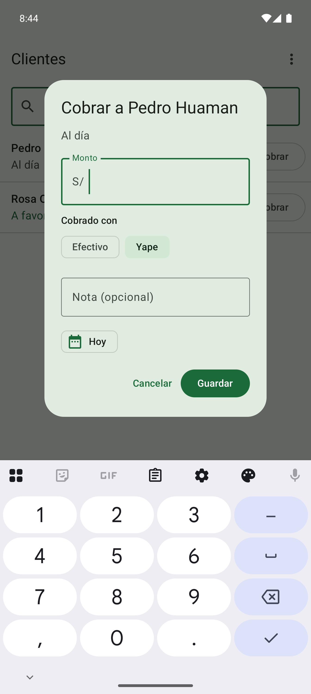
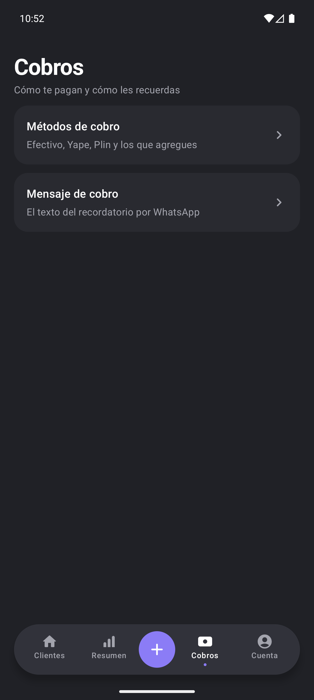
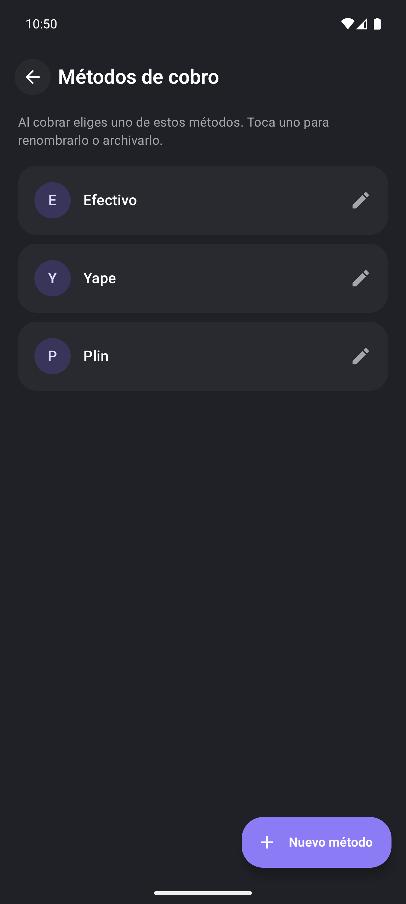
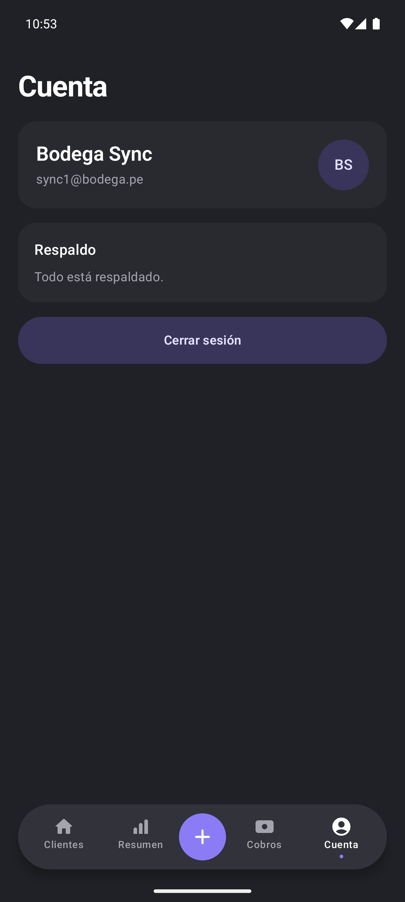

# Fiado

[](https://github.com/FIIADOAPP/FIIADO-MOBILE/actions/workflows/ci.yml)

Libreta de fiado para bodegas pequeñas del Perú. Reemplaza el cuaderno donde el bodeguero anota quién le debe y cuánto: suma sola, recuerda los cobros por WhatsApp y funciona completa sin internet.

Es una app Android nativa con los datos en el teléfono (Room como fuente de verdad). El servidor, [FIIADO-API](https://github.com/FIIADOAPP/FIIADO-API), solo respalda y restaura.

- Plan por fases: [docs/roadmap.md](docs/roadmap.md)
- Decisiones de arquitectura: [docs/adr](docs/adr/README.md)

## Capturas

<p>
  
  
  
  
  
  
  
  
  
</p>

## Estado

| Módulo | Estado |
|---|---|
| Esqueleto (Compose, Hilt, módulos, lint) | Listo |
| Clientes (lista con saldo, búsqueda, alta, edición, archivado) | Listo |
| Movimientos: fiar y cobrar en dos toques, deshacer al instante | Listo |
| Métodos de cobro propios, con el método obligatorio en cada pago | Listo |
| Historial por cliente con anulación, y resumen de hoy y del mes con lo cobrado por método | Listo |
| Cuenta opcional: crear, verificar el correo, iniciar sesión cediendo el dispositivo y recuperar la contraseña | Listo |
| Sincronización: cola de cambios pendientes, guardada junto con cada cambio | Listo |
| Sincronización: envío de la cola en segundo plano al haber red | Listo |
| Sincronización: restauración reanudable al iniciar sesión, unida con la libreta local | Listo |
| Sincronización: estado del respaldo y avisos al cerrar sesión o ceder el teléfono | Listo |
| Recordatorio por WhatsApp con un mensaje de cobro editable | Listo |
| Diseño oscuro con tarjetas y barra inferior flotante | Listo |
| Plazo de pago al fiar | Listo |
| Prórrogas: dar más plazo a un fiado | Listo |
| Puntualidad: semáforo, «Cómo paga» y lo que vence | Listo |
| «Cómo te pagan» en el resumen y avisos al fiar | Listo |
| Bloqueo opcional con la huella o el PIN del teléfono | Listo |
| Release firmado: AAB para Google Play y APK en cada release de GitHub | Listo |
| Versión 1.0 solo en el teléfono, con la copia de seguridad de Google | Listo |
| Banner de AdMob en Clientes y Resumen, y compra única para quitarlo | Listo |

## Requisitos

- JDK 21
- Android SDK con la plataforma 37
- Node.js 20 o superior, solo para el hook de mensajes de commit
- Para la cuenta y el respaldo: [FIIADO-API](https://github.com/FIIADOAPP/FIIADO-API) `v0.4.0` o superior

## Cómo ejecutarlo

```bash
npm install
```

Instala commitlint y activa el hook `commit-msg`. Un mensaje que no siga Conventional Commits, o que incluya líneas de coautoría, se rechaza.

```bash
./gradlew installDebug
```

Compila e instala la app en el dispositivo o emulador conectado. La libreta funciona sin servidor.

El build `debug` ofrece la cuenta; el `release` no, salvo que se compile con `-Pfiado.cuentaRelease=true` (ADR-0010). La cuenta necesita [FIIADO-API](https://github.com/FIIADOAPP/FIIADO-API) corriendo con `docker compose up` en tu PC; los códigos por correo se ven en Mailpit (`http://localhost:8025`). El emulador llega a la API en `http://10.0.2.2:8000/`. Para un teléfono en el mismo wifi, indica la IP de tu PC:

```bash
./gradlew installDebug -Pfiado.apiUrl=http://192.168.1.20:8000/
```

```bash
./gradlew spotlessCheck lint test
```

Ejecuta ktlint, Android Lint y las pruebas. `./gradlew spotlessApply` corrige el formato.

```bash
./gradlew connectedDebugAndroidTest
```

Ejecuta las pruebas instrumentadas en el dispositivo o emulador conectado. Verifican lo que Robolectric no puede emular, como el modo de journal real de SQLite. No corren en el CI.

## Release firmado

Al publicar un release en GitHub, el workflow `Release` compila el AAB para Google Play y el APK firmados y los adjunta al release ([ADR-0009](docs/adr/0009-firma-y-publicacion.md)). Necesita una sola configuración inicial:

1. Genera la clave de subida **fuera del repositorio** y guarda una copia del `.jks` y de sus contraseñas en otro lugar seguro. Sin ella no se pueden publicar actualizaciones hasta que Google la reemplace.

   ```bash
   keytool -genkeypair -v -keystore fiado-subida.jks -storetype PKCS12 -alias subida -keyalg RSA -keysize 2048 -validity 10000
   ```

2. En *Settings → Secrets and variables → Actions* del repositorio, crea estos secretos:
   - `FIRMA_KEYSTORE_BASE64`: el `.jks` en base64. En PowerShell: `[Convert]::ToBase64String([IO.File]::ReadAllBytes("fiado-subida.jks"))`.
   - `FIRMA_CLAVE` y `FIRMA_CLAVE_ALIAS`: las contraseñas que elegiste.
   - `FIRMA_ALIAS`: `subida`.

   Y, solo si quieres ofrecer la cuenta y el respaldo en el servidor, esta variable:
   - `API_URL_RELEASE`: la URL pública de la API terminada en `/`, por ejemplo `https://fiado-api.onrender.com/`. Sin ella, la app sale sin cuenta y guarda la libreta solo en el teléfono ([ADR-0010](docs/adr/0010-version-1-solo-en-el-telefono.md)).

   Y, para cobrar por los anuncios ([ADR-0011](docs/adr/0011-publicidad-y-compra-para-quitarla.md)), estas variables con los ids de tu cuenta de AdMob:
   - `ADMOB_APP_ID`: el ID de la app, por ejemplo `ca-app-pub-1234567890123456~1234567890`.
   - `ADMOB_BANNER`: el ID del bloque de anuncios de banner, por ejemplo `ca-app-pub-1234567890123456/1234567890`.

   Sin ellas, el release lleva los anuncios de prueba de Google. El build `debug` siempre los usa.

3. Para firmar en tu PC, exporta las mismas variables y compila:

   ```bash
   export FIRMA_ARCHIVO=/ruta/fiado-subida.jks FIRMA_CLAVE=... FIRMA_ALIAS=subida FIRMA_CLAVE_ALIAS=...
   ./gradlew bundleRelease
   ```

En Google Play Console, activa *Play App Signing* y sube el AAB: Google firma con su propia clave lo que instalan los usuarios.

## Estructura

| Módulo | Contenido |
|---|---|
| `app` | Punto de entrada: tema, navegación entre funcionalidades y configuración de Hilt. |
| `core:domain` | Modelo, reglas del negocio y contratos de repositorio. Kotlin puro, sin dependencias de Android. |
| `core:data` | Room como fuente de verdad. Implementa los contratos del dominio. |
| `core:ui` | Componentes de interfaz compartidos entre funcionalidades. |
| `core:testing` | Repositorios falsos en memoria para las pruebas de los ViewModels. |
| `feature:clientes` | Pantallas y ViewModels de clientes. |
| `feature:cuenta` | Cuenta opcional: registro, verificación, inicio de sesión y recuperación. |
| `feature:movimientos` | Registro de fiados y pagos, historial por cliente, resumen y métodos de cobro. |
